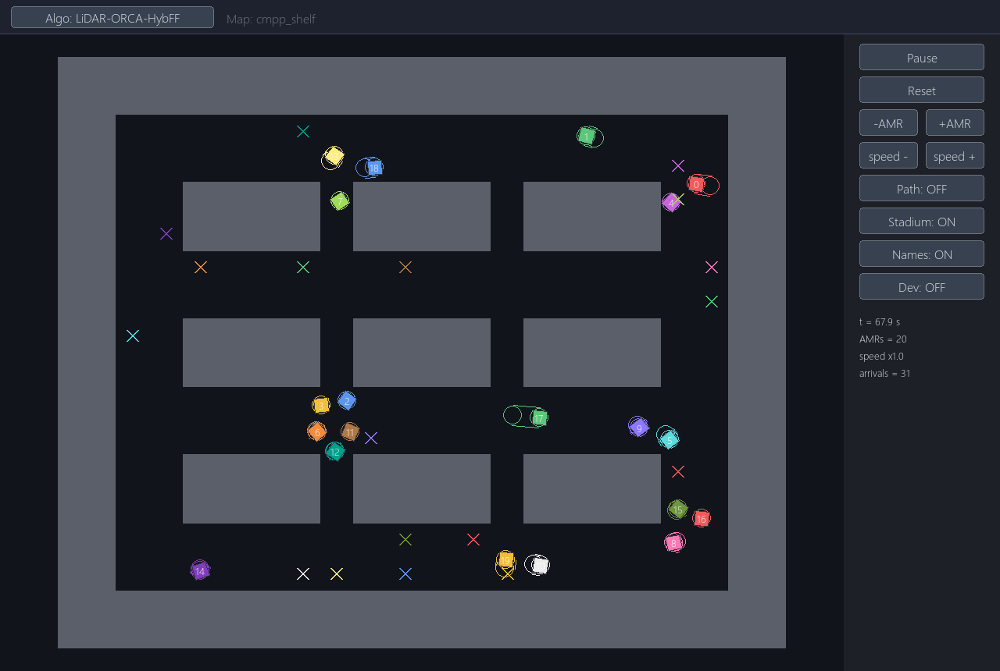

# intersection-orca

A 2D simulator of autonomous mobile robots (AMRs) in a shelf warehouse. Every robot drives to a
random goal, gets a new goal as soon as it arrives, and avoids walls and the other robots with
ORCA. There is no central coordination: each robot plans its own path and reacts only to what its
LiDAR sees.



## Quick start

```
pip install -r requirements.txt
python main.py                                  # viewer
python main.py run 20 0 300                     # headless: 20 robots, seed 0, 300 s
python main.py run 20 0 300 LiDAR-ORCA          # same with the other algorithm
```

Tested with Python 3.12. The numba kernels compile on the first run (about 15 s) and are cached
afterwards.

A headless run prints the number of arrivals and how many time steps had a robot-robot or
robot-wall overlap:

```
LiDAR-ORCA-HybFF  n=20 seed=0  300s simulated in 43.4s
  arrivals=71  (14.20/min)
  steps with car-car overlap=0  steps with wall overlap=0
```

## Viewer

| Input | Action |
|---|---|
| Space | play / pause |
| R | reset (same seed) |
| N / P | add / remove a robot |
| + / - | simulation speed (x1 = 5 simulated seconds per real second) |
| T | show planned paths |
| S | show the braking-distance outline |
| I | show robot ids |
| Algo button | switch between the two algorithms |
| Dev button, then B / F | record history and step 1 s back / forward |
| mouse drag, wheel | pan, zoom |
| Q / Esc | quit |

Each robot's goal is drawn as an x in the robot's color. The viewer pauses by itself when a body
overlaps a wall or another body and shows the reason under "STOPPED".

## The two algorithms

| | Global path | Path following | Avoidance |
|---|---|---|---|
| `LiDAR-ORCA-HybFF` (default) | Hybrid-A* (heading, curvature, acceleration aware) | feed-forward steering + curvature speed limit | ORCA + braking guard |
| `LiDAR-ORCA` | Lazy Theta* (straight segments) | pure pursuit | ORCA |

Both plan a path once per goal. Every step, ORCA takes the direction toward the path as the
preferred velocity and returns the velocity closest to it that does not collide with the walls or
the visible neighbors within 3 s. The robot steers toward that velocity and caps its speed with it.

Results for 20 robots, seed 0, 300 s:

| | Arrivals | Steps with robot-robot overlap | Steps with wall overlap |
|---|---|---|---|
| LiDAR-ORCA-HybFF | 71 | 0 | 0 |
| LiDAR-ORCA | 40 | 0 | 83 |

LiDAR-ORCA touches walls because pure pursuit cuts corners of the polyline paths between
shelves. HybFF's smooth paths and its braking guard ("can I still stop before the wall or the car
ahead if I turn this way?") avoid that.

## How one step works

`Simulation.step()` in `sim/simulation.py`, every `dt` = 0.1 s:

1. **Sense.** Each robot's LiDAR sees the neighbors within 141 px (20 body radii) that are not
   hidden behind walls or other robots (`sim/lidar.py`). It observes positions only; a neighbor's
   velocity is estimated from its position one step earlier.
2. **Avoid.** ORCA (`sim/orca.py`) turns each visible neighbor and up to three walls (the nearest
   one, the one opposite to it, the one ahead) into half-plane constraints on the velocity and
   solves a 2D linear program.
3. **Move.** Each robot computes its next state from the same snapshot (`AMR.plan_step` in
   `sim/vehicle.py`): steer toward ORCA's direction, drive at ORCA's speed (also limited by the wall
   braking distance, the path end and the robot ahead), then clamp to the vehicle limits
   (acceleration, angular acceleration, max speed, max turn rate) and integrate the unicycle model.
4. **Arrive.** A robot whose whole body is inside its goal cell counts as arrived and gets a new
   random goal and a new path.
5. **Check.** Any overlap is recorded in `collision_stop` / `collision_stop_reason`. Nothing is
   pushed apart; overlaps are reported, not hidden.

## Code

| File | Contents |
|---|---|
| `main.py` | entry point: viewer, headless run |
| `config.json`, `sim/config.py` | settings |
| `sim/simulation.py` | `Simulation` (LiDAR-ORCA) and `HybFFSimulation` (LiDAR-ORCA-HybFF): goals, step loop, ORCA step, speed limits, braking guard, collision check |
| `sim/vehicle.py` | `AMR`: unicycle model, path following, motor limits. `Path` |
| `sim/orca.py` | ORCA half-planes and the linear programs (port of RVO2) |
| `sim/lidar.py` | LiDAR visibility (occlusion by walls and robots) |
| `sim/theta_star.py` | Lazy Theta* grid planner |
| `sim/hybrid_astar.py`, `sim/_hybrid_astar_nb.py` | Hybrid-A* planner (search in numba) |
| `sim/walls.py` | map loading, wall distances, ray casts, inflated map for planning |
| `sim/viewer.py` | pygame viewer |
| `maps/cmpp_shelf.json` | the map |

To read the simulation state, e.g. for logging:

| | |
|---|---|
| `sim.t`, `sim.dt`, `sim.agents`, `sim.arrivals` | time, step, robots, arrival count |
| `amr.id`, `amr.pos`, `amr.theta`, `amr.v`, `amr.omega` | robot state |
| `amr.goal.x`, `amr.goal.y` | current goal |
| `amr.path.waypoints` | planned global path |
| `amr.visible_ids` | ids of the neighbors the LiDAR sees this step |
| `sim.map.obstacles`, `sim.walls.nearest_wall(p)` | wall polygons, gap and normal at a point |

```python
from main import make_sim
sim = make_sim("LiDAR-ORCA-HybFF", n=20, seed=0)
for _ in range(3000):          # 300 s
    sim.step()
    for a in sim.agents:
        print(sim.t, a.id, a.pos[0], a.pos[1], a.goal.x, a.goal.y)
```

## Configuration

`config.json`:

| Key | Default | Meaning |
|---|---|---|
| `map` | `cmpp_shelf` | file `maps/<map>.json` |
| `num_amrs` | 20 | number of robots |
| `seed` | 0 | random seed (spawn positions, goals) |
| `dt` | 0.1 | time step [s] |
| `amr_length`, `amr_width` | 10, 10 | body size [px] |
| `max_speed` | 14.37 | [px/s] |
| `accel` | 5.39 | acceleration and braking [px/s^2] |
| `max_angular_velocity` | 0.7854 | [rad/s] |
| `max_angular_accel` | 0.7854 | [rad/s^2] |

Units are pixels and seconds; 1 px = 55.7 mm. The vehicle values come from a real AMR datasheet
(0.8 m/s, 0.3 m/s^2, 45 deg/s, 740 x 545 mm body; the 10 x 10 px body has the same 787 mm rotating
diameter). Runs are deterministic: the same seed gives the same result.

## Map format

`maps/cmpp_shelf.json`: `workspace_bounds` [minx, miny, maxx, maxy], `obstacles` (polygons, px)
and `grid` (cell size and counts). Goals are the centers of the grid cells whose center is free; a
robot arrives when its whole body is inside the cell.
